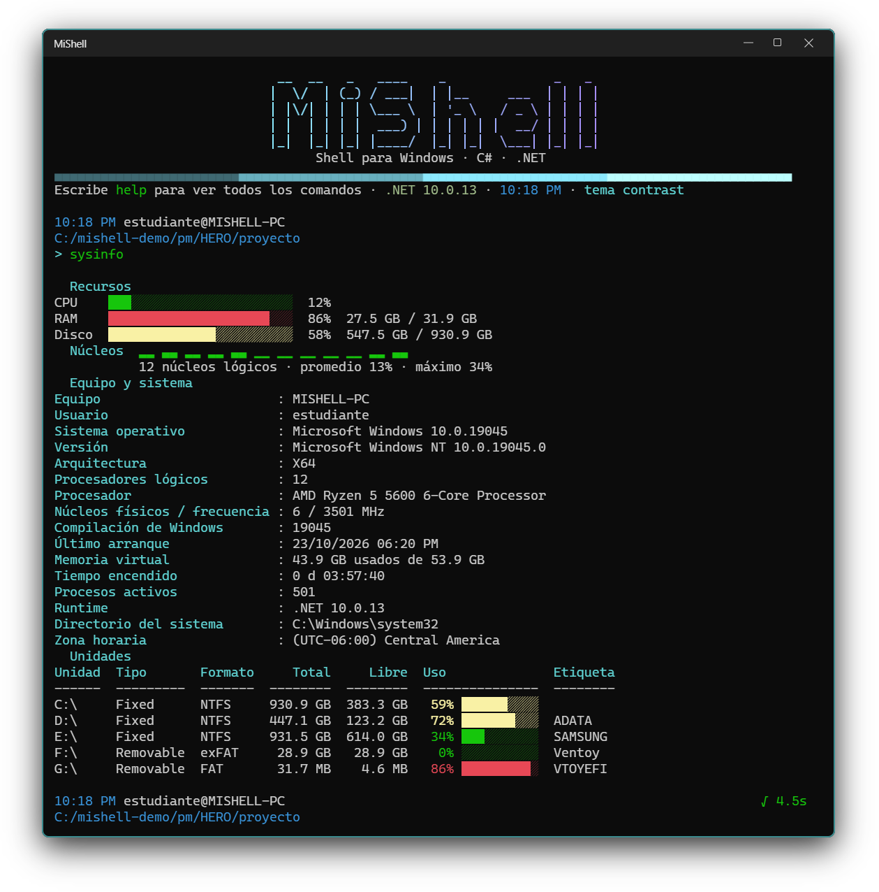

<h1 align="center">MiShell</h1>

<p align="center"><strong>Una shell para Windows hecha en C# y .NET 10</strong><br>
Ejecuta comandos internos y programas externos, conecta sus flujos con tuberías y redirecciones y administra trabajos en segundo plano.</p>

<p align="center"></p>

## Características

- **Ciclo interactivo completo:** prompt de tres líneas con hora, ruta y código de salida, historial, autocompletado con Tab y resaltado del comando mientras se escribe.
- **Procesos reales:** crea, conecta y espera procesos de Windows; `trace on` muestra cada paso (crear, esperar, código de salida). `start`, `suspend`, `resume` y `kill` controlan los trabajos, y `ps` y `top` muestran el estado de cada proceso.
- **Salida legible:** fechas `dd/MM/yyyy` con hora de 12 horas, tamaños siempre con unidad (B, KB, MB, GB) y mensajes que confirman lo ocurrido (`✓ Creado saludo.txt (11 B)`).
- **Ayuda con ejemplos:** `help` muestra cada comando con su nombre en Linux y en Windows (`ls`/`dir`, `cat`/`type`, `rm`/`del`), `help <comando>` incluye ejemplos y `help pipes`, `help redirect`, `help jobs` y `help vars` explican los temas.
- **Sintaxis de shell:** tuberías `|`, redirecciones `>`, `>>`, `<`, operadores `&&` y `||`, segundo plano con `&`, variables y scripts con `source`.
- **Comandos internos detallados:** `ls`, `ps`, `top`, `sysinfo`, `which`, `cat` y otros entregan al menos la información de sus equivalentes de Windows, con barras y colores por tema.
- **Código modular:** seis proyectos, un archivo por comando y 127 pruebas automatizadas.

Shell educativo de Windows escrito en C#/.NET 10. Ejecuta comandos internos y programas externos, conecta sus flujos de entrada/salida y administra trabajos básicos.

## Inicio rápido

Requiere Windows 10/11 y el SDK de .NET 10. Para la interfaz interactiva se recomienda Windows Terminal. PowerShell 7 permite ejecutar la verificación del repositorio.

```powershell
dotnet run --project .\MiShell.App\MiShell.App.csproj
```

Dentro de MiShell:

```text
help
help ps
help syntax
ls -l
ps 10 --name dotnet --sort ram
top
start notepad.exe
theme contrast
source demo.mish
exit
```

La demo crea `.mish-demo` en el directorio inicial y conserva la sesión abierta. Usa ejecutables de Windows (`cmd.exe`, `findstr.exe`, `powershell.exe`); no requiere herramientas de Unix.

## Comandos frente a los de Windows

Cada comando interno se comparó con su equivalente de `cmd` y PowerShell para que no muestre menos información.

| MiShell | Equivalente | Información que entrega |
|---|---|---|
| `ls` / `dir` | `dir`, `Get-ChildItem` | Modo (`d a r h s l`), fecha `dd/MM/yyyy` con hora de 12 horas, tamaño con unidad, nombre, totales y espacio libre. `-l` añade creación y acceso; `-a` ocultos; `-b` bytes exactos; `-R` recursivo; `-t`/`-S`/`-r` orden; patrones como `*.txt`. |
| `ps` | `Get-Process`, `tasklist` | PID, estado (Ejecutando, En espera, Suspendido), hilos, CPU, memoria con unidad, % de RAM e inicio de todos los procesos legibles; `-l` añade handles, sesión y memoria privada; `--chart` y `--group` grafican la memoria. `ps --id PID` muestra ruta, versión, prioridad, núcleos permitidos y memoria pico/virtual. |
| `top` | `top`, `htop` | Monitor en vivo: carga por núcleo, CPU y RAM con historial, procesos por estado y tabla que llena la ventana; `c m p n e` ordenan y `q` sale; `--pid N` vigila un proceso. |
| `start`, `suspend`, `resume`, `kill`, `jobs`, `fg` | `Start-Process`, `Suspend-Process`, `taskkill`, `Get-Job` | Lanza un programa como trabajo, lo pausa y reanuda (equivalente de SIGSTOP/SIGCONT) y lo espera o termina. |
| `sysinfo` | `systeminfo` | CPU, RAM y disco con barras, histograma de carga por núcleo, barras de uso por unidad, más equipo, SO, procesador, núcleos, arranque, memoria virtual y todas las unidades. |
| `which` | `Get-Command`, `where` | Tipo (interno/externo), versión, tamaño, fecha y ruta; `-a` todas las coincidencias. |
| `cat` / `type` | `type`, `Get-Content` | Varios archivos con encabezado, `-n`, `--head`, `--tail`. |
| `mkdir` / `md` | `mkdir`, `New-Item` | Crea la ruta completa y muestra una tabla con lo creado. |
| `rm` / `del`, `rmdir` / `rd` | `del`, `rd /s`, `Remove-Item` | Elimina archivos, patrones y carpetas; pide confirmación para carpetas con contenido (salvo `-f`) y nunca borra la raíz de una unidad ni la carpeta actual. |
| `cd`, `pwd` | `cd`, `Set-Location`, `Get-Location` | `cd -`, `/d`, rutas con espacios; `pwd` muestra un encabezado `Path` como PowerShell y `pwd -v` añade unidad y espacio libre. |
| `set`, `unset` | `set`, `Remove-Item Env:` | Lista, filtra por prefijo, define (con valor anterior) y elimina. |
| `history`, `time`, `version` | `history`, `Get-Date`, `ver` | Historial numerado y filtrable; fecha, UTC, ISO y semana; versión de MiShell, runtime y SO junto con el equipo de desarrollo y la asignatura. |

## Formato de salida y estructura del código

- Las tablas y listas se muestran por defecto en **columnas alineadas** como `dir` y `Get-ChildItem` (encabezado subrayado, sin bordes, directorios resaltados). `format boxed` cambia a tablas con bordes y `format classic` vuelve; la elección se guarda en `settings.json`. Con la salida redirigida se escribe texto separado por tabuladores. Tras una redirección (`>` o `>>`) MiShell informa si el archivo se creó, se reemplazó o se amplió, y si no pudo escribirlo explica por qué.
- En una terminal interactiva se deja una línea en blanco entre la orden, su salida y el siguiente prompt.
- `top` es un monitor en vivo (núcleos, CPU y RAM con historial, estados y procesos) que se cierra con `q` o `Esc`. Windows no informa en qué núcleo corre cada proceso, así que la columna Núcleos indica cuántos núcleos equivalentes consume.
- `MiShell.Commands` tiene un archivo por comando, agrupados en `Files`, `Navigation`, `Processes`, `Session`, `SystemInfo` y `Help`. El texto de `help` está en `Help/help.json` (recurso embebido).
- Las tuberías externas las gestiona `MiShell.Core/Execution/ExternalPipeline.cs`, que es dueña de los procesos, los archivos y las copias de flujos y los libera siempre en el mismo orden.

## Colores y lectura

| Opción | Uso |
|---|---|
| `theme contrast` | Fondo oscuro; acento cian. Predeterminado para perfiles nuevos. |
| `theme paper` | Fondo claro; texto oscuro y acento azul. |
| `theme plain` | Texto sin color, tablas simples y sin animación de bienvenida. |
| `theme list` | Consulta todos los temas; se conservan dracula, synthwave, crt y minimal. |

Cada tema asigna un color a un **rol** y el mismo rol se usa en todo el programa, de modo que se reconozca a primera vista:

| Rol | Dónde aparece (tema `contrast`) |
|---|---|
| Ruta (`Path`) | Rutas del prompt, `cd`, `which` y `mkdir` (azul cian); `pwd` usa el color de directorios |
| Hora (`Time`) | Hora de 12 horas con AM/PM en el prompt, el banner, `top` y `jobs` (cian oscuro) |
| Equipo (`Host`) | `usuario@equipo` (gris) |
| Etiqueta (`Tag`) | Nombre del tema en el banner (gris suave) |
| Comando (`Command`) | Nombres en `help`, `which`, `set` y el comando válido mientras se escribe (verde) |
| Directorio (`Directory`) | Carpetas en `ls` (cian); ejecutables en verde, ocultos y enlaces atenuados |
| Texto secundario (`Muted`) | Descripciones, fechas y tamaños (gris) |
| Estado | Éxito en verde, error en rojo, avisos en amarillo; `ps` marca la RAM sobre 500 MB y sobre 1 GB y colorea el estado del proceso |

Los temas no cambian el fondo de tu terminal. Los colores son de la paleta de 16 tonos del terminal, así que combinan con el esquema que uses, y el color siempre se acompaña de texto, símbolos y códigos. La preferencia existente del usuario se conserva. `NO_COLOR=1` desactiva el color de MiShell; los programas externos conservan su propio comportamiento. Los archivos redirigidos no reciben colores ni bordes.

## Sintaxis y uso

```text
echo Hola > saludo.txt
echo Otra linea >> saludo.txt
cat < saludo.txt
cmd.exe /c echo Hola | findstr.exe Hola > coincidencias.txt
powershell.exe -NoProfile -Command "Start-Sleep -Seconds 2" &
jobs
fg 1
start powershell.exe -NoProfile -Command "Start-Sleep -Seconds 60"
suspend %1
resume %1
kill %1
rm saludo.txt
set SALUDO="Hola mundo"
echo $SALUDO
```

- `>` reemplaza el archivo; `>>` añade contenido; `<` lee entrada. Se admite una entrada y una salida por comando. Se rechaza escribir sobre el archivo de entrada o usar dos destinos iguales en una tubería.
- Las tuberías conectan programas externos y un comando interno puede ser la **primera etapa** (`ls | findstr.exe txt`, `echo Hola | findstr.exe Hola`); un interno en otra posición se rechaza con una explicación. `&` sigue limitado a programas externos. Los internos admiten salida a archivo; `cat`/`type` también entrada desde archivo. `trace on` muestra la creación, espera y fin de cada proceso.
- `&` solo puede terminar una tubería; no se combina con `&&`/`||`. `fg` espera toda la tubería y devuelve el código del último proceso. Los trabajos fallidos muestran código o causa; un fallo de transferencia termina los procesos y libera sus flujos.
- `kill %1` identifica un job; `kill 1234` identifica un PID; `suspend` y `resume` aceptan lo mismo. Salir cierra los trabajos que todavía pertenecen a MiShell.
- `&&`/`||` condicionan la ejecución según el código previo. Las variables se expanden al analizar la línea: define y utiliza una variable en líneas separadas.
- Las comillas dobles expanden variables; las simples conservan texto literal. La sintaxis es un subconjunto de la de una shell: variables, comillas, operadores y redirecciones, sin escape con barra invertida ni sustitución de comandos.
- `.cmd`/`.bat` requieren `cmd.exe /c archivo.cmd`; `.ps1` requiere `powershell.exe -File archivo.ps1`.
- `source` ejecuta líneas y comentarios completos `#`; reporta archivo/línea y conserva un código de fallo si alguna línea falla.
- Ctrl+C cancela el comando actual; mientras escribes, borra esa entrada. Ctrl+Z o EOF termina la sesión. Flechas recuperan el historial. Tab completa internos, ejecutables del PATH vigente y rutas con espacios, conservando prefijos y comillas; también conserva el texto posterior al cursor.

Configuración e historial se guardan en `%APPDATA%\MiShell`. `MISHELL_DATA_DIR` permite usar un perfil separado, como hacen las pruebas. Las órdenes introducidas se guardan localmente en el historial.

## Verificación

```powershell
dotnet build MiShell.slnx -c Release
dotnet test MiShell.slnx -c Release
pwsh -File .\scripts\verify.ps1
```

Para comprobar además los contadores y WMI del equipo:

```powershell
pwsh -File .\scripts\verify.ps1 -IncludeSystemInfo
```

El script usa una carpeta temporal y un perfil aislado, comprueba archivos y salidas, limita la duración de la demo y guarda resultados en `artifacts/validation/`, excluido de Git. `-SkipBuild` reutiliza una compilación Release ya realizada.

Resultado local del 23 de octubre de 2026: **127 pruebas, 0 fallos; Release con 0 advertencias; demo 12/12**. El detalle está en [validación](docs/validation.md).

## Organización

```text
MiShell.Core/             Parser, AST, procesos, jobs, historial y contratos
MiShell.Commands/         Comandos internos, archivos, procesos y scripts
MiShell.UI/               Prompt, editor de línea, temas y Spectre.Console
MiShell.Configuration/    Configuración persistente
MiShell.App/              Registro de servicios y ciclo REPL
MiShell.Core.Tests/       Pruebas unitarias, integración de procesos y sesiones
scripts/                 Verificación reproducible
docs/                    Cumplimiento, explicación técnica y defensa
```

Core no referencia Spectre.Console. Commands sí referencia UI y Configuration: la solución separa responsabilidades por proyectos, sin imponer una arquitectura nueva.

## Proyecto académico

MiShell es un proyecto de carácter académico para la asignatura Arquitectura de Sistemas Operativos. Muestra cómo una shell analiza una línea, crea y espera procesos y conecta sus flujos de entrada y salida.

- [Explicación técnica del funcionamiento](docs/technical-guide.md)
- [Evidencia de validación](docs/validation.md)
