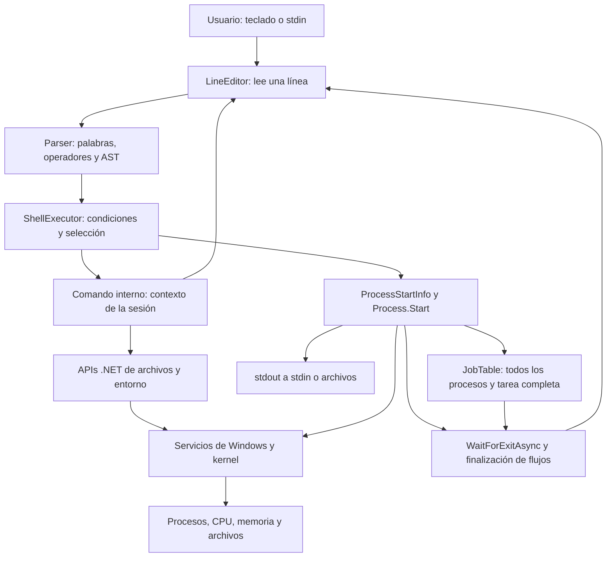

# Cómo MiShell interactúa con Windows

Explicación técnica de cómo MiShell analiza una línea, crea y espera procesos y conecta sus flujos en Windows.

## Flujo de una orden

El shell interpreta y solicita operaciones al SO. No implementa el kernel ni un planificador de CPU.

## Componentes y datos

| Proyecto | Responsabilidad |
|---|---|
| Core | AST, parser, resolución, ejecución, jobs, historial y contratos |
| Commands | Internos de navegación, archivos, entorno, procesos, ayuda y scripts |
| UI | Edición, prompt, colores y Spectre |
| Configuration | Preferencias persistentes |
| App | Registro de dependencias, cancelación y REPL |
| Core.Tests | Pruebas unitarias y de integración de toda la aplicación |

Commands referencia Core, UI y Configuration. Core no depende de Spectre. Se mantuvo esa organización.

`CommandSpec` contiene ejecutable, argumentos y redirecciones. `ChainedPipeline` agrupa etapas y condición. El parser conserva la diferencia entre operadores y texto entre comillas.

## Crear, ejecutar y esperar

`ProcessStartInfo` configura nombre, argumentos y directorio, con `UseShellExecute=false`. `Process.Start` inicia un proceso de Windows con un PID independiente. Windows asigna memoria y programa sus hilos. En primer plano, MiShell espera etapas y flujos antes de leer otra orden. [Microsoft: Process.Start](https://learn.microsoft.com/en-us/dotnet/api/system.diagnostics.process.start?view=net-10.0).

En POSIX, fork duplica el proceso, exec reemplaza su imagen y wait/waitpid espera un hijo. Windows utiliza otro modelo de creación. **La correspondencia de objetivos no implica equivalencia literal de llamadas ni semántica de fork.** La propuesta recomienda C# en p. 1 y exige C en otras páginas; su aceptación corresponde al docente. [Microsoft: creación de procesos Win32](https://learn.microsoft.com/en-us/windows/win32/procthread/creating-processes).

## Entrada, salida, error y tuberías

En `cmd /c echo Hola | findstr Hola`, MiShell copia bytes de stdout de la primera etapa a stdin de la segunda y cierra el destino al terminar. Lee stderr en paralelo para evitar que su buffer bloquee el proceso. Devuelve el código de la última etapa.

`<` abre entrada; `>` abre/trunca salida y `>>` añade. Las entradas se abren antes de truncar salidas: una entrada faltante no borra una salida existente. La redirección explícita sustituye ese extremo del pipe.

Los internos corren dentro de MiShell. Un scope del renderer cambia su salida, incluidas tablas, hacia el archivo. `cat`/`type` leen stdin; los demás rechazan `<`. Los internos no participan en pipes ni en `&`.

Los pipes externos copian bytes sin recodificar. Los archivos y mensajes internos usan UTF-8; la codificación de cada externo depende de ese programa.

## Trabajos, cancelación y cierre

El job conserva **todas** las etapas, PID y una tarea que completa procesos y flujos. `jobs` muestra esos PID. `fg` espera esa tarea y devuelve el código real. `kill %1` identifica un job; un número sin `%` identifica un PID.

Ctrl+C cancela el comando, solicita terminar sus árboles de procesos y mantiene la sesión. Cada comando recibe otro token. Cancelar `fg` termina el job esperado. Salir cierra los trabajos pendientes y libera handles. [Microsoft: WaitForExitAsync](https://learn.microsoft.com/en-us/dotnet/api/system.diagnostics.process.waitforexitasync?view=net-10.0).

`Process.Kill(entireProcessTree: true)` solicita terminar descendientes; esperar el proceso padre no demuestra que todos los descendientes posibles terminaron. Las pruebas verifican los procesos rastreados y el caso concreto de cancelación. [Microsoft: Process.Kill](https://learn.microsoft.com/en-us/dotnet/api/system.diagnostics.process.kill?view=net-10.0).

## Recursos del sistema

- `ps` libera los handles que consulta. RAM es working set en MiB; CPU son segundos acumulados. Filtra por nombre y ordena por RAM, CPU o PID.
- Las barras comparan los valores mostrados; no indican una alarma de falta de memoria.
- `sysinfo` usa contadores para una muestra de CPU, WMI para RAM y la unidad de la ruta actual para disco. Informa MiB/GiB y espacio libre.
- Contadores/WMI pueden fallar por disponibilidad o permisos: se comunica el error, sin inventar capacidad.

## Fuente de la consigna

`Propuesta #1.pdf`, pp. 1-6, documento local de clase usado en la matriz. No se redistribuye. Las páginas de Microsoft enlazadas respaldan la explicación del modelo Windows/.NET; no resuelven la contradicción académica del lenguaje.

## Cierre de opciones y errores

CompletionProvider consulta el PATH vigente sin índice permanente y conserva prefijos y comillas. LineEditor reemplaza el texto anterior al cursor conservando el sufijo; recalcula el ancho cuando detecta un cambio de ventana.

sysinfo usa una espera cancelable y una consulta WMI para ambos valores de RAM. Los errores de recursos se explican y devuelven código 1.

ShellExecutor valida entrada y salida antes de abrir stdout. Una copia fallida cancela la espera y termina los procesos; la tarea del job conserva la causa. jobs muestra estado y resultado, fg elimina el trabajo incluso ante fallos y las notificaciones distinguen código 0 de error.
